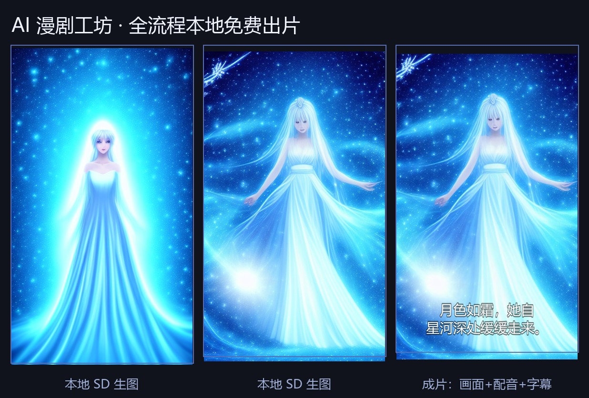

# 🎬 AI Comic Drama Studio

<p align="center">
  
</p>

<p align="center">
  <b>English</b> · <a href="README.md">简体中文</a>
</p>

<p align="center">
  <a href="https://github.com/weiguoyi-ai/ai-comic-drama/actions/workflows/ci.yml"></a>
  
  
</p>

An open-source tool that turns a story or script into a **vertical short-form "comic drama" video**: AI writes the storyboard, generates one image per shot, synthesizes per-character voice-over, burns in subtitles, and renders a ready-to-post MP4.

**Three run modes**: cloud API (best quality) / **fully local & offline (free forever)** / auto-switch.

## ✨ Features

| Module | Description |
|---|---|
| 📝 Script → storyboard | LLM splits your story into structured shots (title / narration / dialogue / **speaker** / image prompt) |
| 🖼 Shot images | Volcano Ark Doubao Seedream, with first-image reference to keep characters consistent |
| 🎭 Multi-character dubbing | Voices are **auto-assigned per character** (stable per character, distinct across characters); per-shot override in the UI |
| 🎵 Background music | Drop tracks into `assets/bgm/` — one is picked at random and mixed in (12% volume, 2s fade-out) |
| 🎬 Video render | ffmpeg: Ken Burns motion + burned-in SRT subtitles → 720×1280 (9:16) or 1280×720 (16:9) |
| 🧪 Mock mode | Full pipeline without any API key (placeholder images + silence) for development |

## 🚀 Quick start

```bash
# 1. Install dependencies (Python 3.10+)
pip install -r requirements.txt

# 2. Start
python server.py

# 3. Open http://127.0.0.1:8000
```

On Windows you can also just double-click `启动.bat`.

## 💰 Zero-cost fully local mode

No GPU? No API key? No problem — the pipeline can run entirely on CPU, offline, forever free.

```bash
# 1. CPU-only torch + local inference deps
pip install torch --index-url https://download.pytorch.org/whl/cpu
pip install -r requirements-local.txt

# 2. Download models (~6GB, one-off; uses ModelScope mirrors in China)
python download_models.py

# 3. Start — local models are detected automatically
python server.py
```

| mode | Behaviour | Cost | Network |
|---|---|---|---|
| `auto` (default) | Use cloud if a key exists, otherwise fall back to local | 0 | optional |
| `local` | Force local: SD1.5 images + Qwen2.5-1.5B storyboard + offline TTS | **free** | **none** |
| `cloud` | Force Volcano Ark (Seedream + Doubao Seed) | pay-per-use / free tier | required |

Local throughput measured on an i5-1135G7 (4 cores, no GPU): **~3–3.7 min per image**, ~1–1.5 min for a storyboard, TTS in seconds.
Tune `local.quality` (`fast` / `normal` / `high`) and `local.steps` in `config.json` to trade speed for quality.

## 🔑 Cloud mode (optional, Volcano Ark)

One key covers both text and image generation:

1. Sign up at [Volcano Ark console](https://console.volcengine.com/ark) and enable `Doubao-Seedream-4.0` + `Doubao-Seed-1.6-flash`
2. Create an API key, then put it in `config.json` → `llm.api_key` and `image.api_key` (or set `ARK_API_KEY`)
3. Run `python check_ark.py` to verify the connection, then refresh the page

Any **OpenAI-compatible** endpoint works too — just change `base_url` / `model` / `api_key`.

## 🎭 Multi-character dubbing

The storyboard stage tags every line with a **speaker**, and voices are resolved in this order:

1. exact match in `tts.voice_map`
2. fuzzy match (e.g. `女主` also matches `女主林晚`)
3. project-level assignment table (`_voices.json`): a new character takes the next unused voice
4. default voice

```json
"tts": {
  "voice": "zh-CN-XiaoxiaoNeural",
  "voice_map": {
    "旁白": { "voice": "zh-CN-XiaoxiaoNeural", "rate": -4 },
    "女主": { "voice": "zh-CN-XiaoyiNeural", "rate": 0 }
  }
}
```

Voice-over uses edge-tts when online, and an offline engine (Piper / Windows SAPI) when local.

## 🎵 Background music

```json
"bgm": { "enabled": true, "path": "", "volume": 0.12 }
```

- `path` empty → random track from `assets/bgm/`; a filename → always that track; `enabled: false` → off
- `volume` 0.05–0.2 keeps dialogue intelligible; a 2-second fade-out is applied automatically

## 📁 Project layout

```
ai-comic-drama/
├── server.py           # FastAPI backend + API
├── providers.py        # provider abstraction (auto/local/cloud + voice assignment)
├── compose.py          # ffmpeg pipeline (Ken Burns + subtitles + BGM mix)
├── local_image.py      # local image generation (SD1.5 + LCM, CPU)
├── local_llm.py        # local storyboard model (Qwen2.5-1.5B)
├── local_tts.py        # offline TTS (Piper / Windows SAPI)
├── download_models.py  # one-click model downloader (ModelScope)
├── check_ark.py        # cloud API key self-check
├── static/index.html   # web UI
├── assets/bgm/         # background music folder (one original sample included)
├── config.example.json # config template
└── projects/           # per-project images, audio and final video
```

## ❓ FAQ

- **piper-tts 1.8.0 on Windows produces empty audio** (hard-coded espeak data path). Handled automatically: empty output triggers a switch to Windows SAPI offline voices.
- **Rendering fails when your Windows username contains non-ASCII characters?** Already fixed — concat and subtitle stages run with `cwd=project_dir` and relative filenames.
- **Images too slow locally?** Set `local.quality` to `"fast"` and `local.steps` to `3` (~2.5 min per image).

## License

[MIT](LICENSE) © 2026 Wei Guoyi
